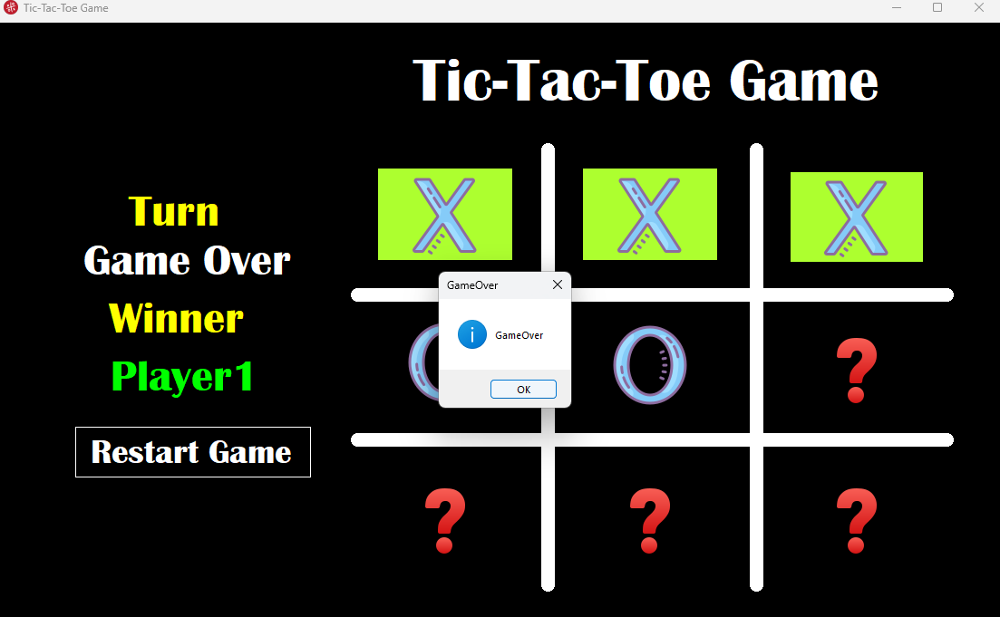
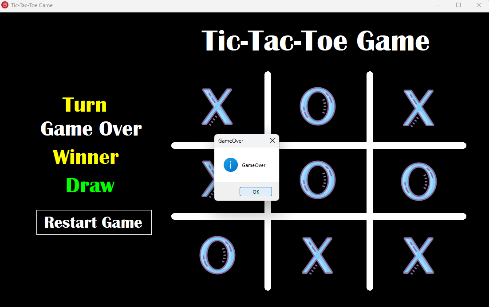

# C# .NET Framework Windows Forms Practice Projects

## Description

A collection of six C# Windows Forms applications developed while learning the C# language and practicing desktop application development using .NET Framework.

These projects were primarily developed for learning and practice purposes. Their implementations reflect my programming experience at the time and may not always follow optimal coding practices, design principles, or production-level standards.

The repository showcases my early experience with C#, Windows Forms, event-driven programming, UI controls, classes, collections, and application logic.

## Projects

### 1. To-Do List Manager


A Windows Forms application for organizing daily tasks and tracking their completion progress.

**Features:**

- Add and remove tasks.
- Create subtasks under existing tasks.
- Check and uncheck tasks and their child items.
- Track individual task completion progress.
- Increase task progress in increments.
- Calculate and display overall completion progress.
- Display the current date and time remaining until the end of the day.
- Display randomized daily motivational quotes.
- Show a notification when all top-level tasks are completed.

**Concepts demonstrated:** TreeView, ProgressBar, NotifyIcon, Timer, event handling, recursion, and collections of UI controls.

### 2. Stopwatch


A simple stopwatch application that tracks elapsed time and records lap times.

**Features:**

- Start, stop, and reset the stopwatch.
- Display elapsed time in hours, minutes, and seconds.
- Record lap times.
- Display lap records using a ListView.
- Track and visually highlight the longest lap.

**Concepts demonstrated:** Windows Forms Timer, structures (`struct`), ListView, event-driven programming, and time calculations.

### 3. Quiz App


A timed multiple-choice quiz application featuring Premier League football trivia.

**Features:**

- Select the quiz difficulty before starting.
- Different time limits depending on the selected difficulty.
- Answer multiple-choice questions.
- Randomize question selection and answer placement.
- Display question progress.
- Track correct answers and the final score.
- Display the game result.
- Restart and play again.

The quiz contains ten questions covering Premier League history.

**Concepts demonstrated:** Multiple Forms, RadioButtons, Timer, enums, multidimensional arrays, randomization, game logic, and event handling.

### 4. Password Generator


A Windows Forms application for generating passwords based on user-selected character types and password length.

**Features:**

- Generate passwords of a selected length.
- Include uppercase letters.
- Include lowercase letters.
- Include numbers.
- Include symbols.
- Display an estimated password strength.
- Copy generated passwords to the clipboard.
- Toggle the visibility of TrackBar tick marks.

**Concepts demonstrated:** Random number generation, enums, collections (`List<T>`), TrackBar, ProgressBar, Clipboard, and event handling.

### 5. Fast Food Restaurant


A simple fast food ordering application that allows users to select menu items and manage their orders.

**Features:**

- Navigate between different menu categories:
  - Pizza
  - Burgers
  - Sandwiches
  - Salads
  - Drinks
- Add and remove items from an order.
- Track item quantities.
- Calculate the order total.
- Display an order summary.
- Confirm and process orders.
- Generate a unique-looking order reference number.
- Copy the order reference to the clipboard.
- View previously processed orders during the application session.

**Concepts demonstrated:** Multiple Forms, Panels, event handling, custom classes, dictionaries (`Dictionary<TKey, TValue>`), static members, collections, Clipboard, and NotifyIcon.

### 6. Tic-Tac-Toe





A two-player Tic-Tac-Toe game built using Windows Forms.

**Features:**

- Two-player gameplay using X and O.
- Interactive 3×3 game board.
- Alternate turns between players.
- Detect winning combinations across rows, columns, and diagonals.
- Highlight the winning combination.
- Detect draw situations.
- Display the winner and game status.
- Restart the game.

**Concepts demonstrated:** Game logic, enums, structures (`struct`), methods, event handling, conditional statements, Graphics drawing, and Windows Forms resources.

## Concepts Demonstrated Across the Projects

- C# Fundamentals
- Object-Oriented Programming Basics
- Classes, Objects, and Methods
- Constructors and Properties
- Static Members
- Enums and Structures
- Collections (`List<T>`, `Dictionary<TKey, TValue>`)
- Arrays and Multidimensional Arrays
- Loops and Conditional Statements
- Random Number Generation
- Event-Driven Programming
- Event Handlers
- Multiple Windows Forms
- Windows Forms Controls
- Timers and Notifications
- Clipboard Operations
- UI Navigation and Interaction
- Basic Application Logic and Problem Solving

## Repository Structure

The repository contains six independent Windows Forms applications.

Each project is organized into its own directory and contains its corresponding source files, Visual Studio project files, and required resources.

The `Screenshots` directory contains six separate folders, with screenshots organized by project.

## How to Clone the Entire Repository

Clone the repository to get all six projects and their screenshots:

```bash
git clone https://github.com/HeshamSallem510/WinForms-Practice-Projects-CSharp.git
```

## How to Clone an Individual Project

Git Sparse Checkout allows you to retrieve only the project directory you want, together with its corresponding screenshots.

For example, to clone only the To-Do List Manager:

```bash
git clone --filter=blob:none --sparse https://github.com/HeshamSallem510/WinForms-Practice-Projects-CSharp.git

cd WinForms-Practice-Projects-CSharp

git sparse-checkout set "Project1To-DoListManager" "Screenshots/To-Do List Manager"
```

Use the following directory pairs to retrieve any of the other projects:

| Project              | Project Directory            | Screenshot Directory               |
| -------------------- | ---------------------------- | ---------------------------------- |
| To-Do List Manager   | `Project1To-DoListManager`   | `Screenshots/To-Do List Manager`   |
| Stopwatch            | `Project2StopWatch`          | `Screenshots/Stop Watch`           |
| Quiz App             | `Project3QuizApp`            | `Screenshots/Quiz App`             |
| Password Generator   | `Project4PasswordGenerator`  | `Screenshots/Password Generator`   |
| Fast Food Restaurant | `Project5FastFoodRestaurant` | `Screenshots/Fast Food Restaurant` |
| Tic-Tac-Toe          | `TicTacToe`                  | `Screenshots/Tic-Tac-Toe`          |

Replace the two directory paths in the `git sparse-checkout set` command with the corresponding pair from the table.

This retrieves the selected project and its screenshots without checking out the other project directories.

> Note: This is a selective checkout of the original repository, not a separate Git repository for that project.

## How to Run

1. Clone the entire repository or select an individual project using Sparse Checkout.
2. Open the desired project directory.
3. Open its Visual Studio solution file (`.sln`).
4. Make sure the corresponding .NET Framework Developer Pack is installed.
5. Build and run the application.

> These applications were developed using C# Windows Forms on .NET Framework and are intended to run on Windows.

## Important Notes

- These applications were created primarily for practicing C# and Windows Forms.
- Some implementations may contain inefficiencies or areas that could be improved.
- The applications are not intended to represent production-ready software.
- The Password Generator uses `System.Random` and should be considered a learning exercise, not a cryptographically secure password generator.
- The Fast Food Restaurant project keeps its order history in memory; it does not provide permanent order storage.

## Author

**Hesham Sallem**

GitHub: [HeshamSallem510](https://github.com/HeshamSallem510)
